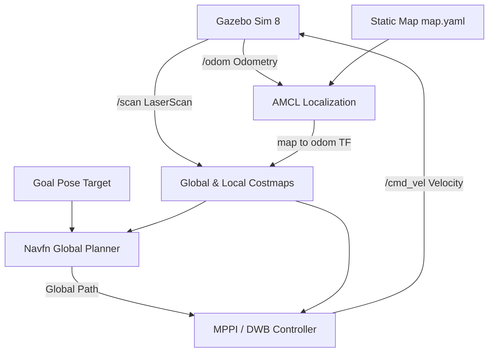

# Autonomous Navigation with TurtleBot3 in ROS 2 & Gazebo

[](https://docs.ros.org/en/jazzy/)
[](https://navigation.ros.org/)
[-orange.svg)](https://gazebosim.org/)
[](https://emanual.robotis.com/docs/en/platform/turtlebot3/overview/)

Autonomous navigation and obstacle avoidance implementation for **TurtleBot3 Burger** using the **ROS 2 Navigation2 (Nav2)** stack in a **Gazebo** simulation environment. Developed as part of the Robotics Software Intern Assignment for **Antropi Robotics**.

---

## 📌 Table of Contents
- [Objective](#-objective)
- [System Architecture](#-system-architecture)
- [Prerequisites](#-prerequisites)
- [Quick Start Guide](#-quick-start-guide)
  - [Option 1: Two-Terminal Run (Recommended)](#option-1-two-terminal-run-recommended)
  - [Option 2: Single Unified Launch](#option-2-single-unified-launch)
- [How to Demonstrate Autonomous Navigation](#-how-to-demonstrate-autonomous-navigation)
  - [Method A: Interactive RViz Goal (GUI)](#method-a-interactive-rviz-goal-gui)
  - [Method B: Automated Python Script](#method-b-automated-python-script)
- [Obstacle Avoidance Mechanism](#-obstacle-avoidance-mechanism)
- [Video Demo Recording Guide](#-video-demo-recording-guide)
- [Repository Structure](#-repository-structure)
- [Challenges Faced & Solutions](#-challenges-faced--solutions)
- [Author](#-author)

---

## 🎯 Objective
1. Set up a **TurtleBot3 Burger** in a Gazebo environment with static/dynamic obstacles (`turtlebot3_world`).
2. Configure the **Nav2** stack (AMCL localization, costmaps, global planner, and local controller) to navigate autonomously from start to goal.
3. Successfully avoid obstacles in real time using 2D LiDAR sensory feedback.
4. Record a 1–2 minute screen demo showing Gazebo and RViz side by side.

---

## 🏗 System Architecture



- **Robot Model:** TurtleBot3 Burger (Differential drive, 2D LiDAR LDS-01, Wheel Encoders).
- **Simulator:** Gazebo Sim 8 (Harmonic) integrated with ROS 2 via `ros_gz_bridge`.
- **Localization:** Adaptive Monte Carlo Localization (AMCL) publishing `map -> odom`.
- **Global Planner:** NavfnPlanner computing shortest collision-free paths.
- **Local Controller:** MPPI / DWB Controller evaluating trajectories and avoiding dynamic obstacles.
- **Costmap System:** 2D Costmap with Static Layer, Obstacle Layer (LaserScan), and Inflation Layer.

---

## 💻 Prerequisites

- **OS:** Ubuntu 24.04 LTS (Native or inside WSL2)
- **ROS Version:** ROS 2 Jazzy Jalisco
- **Key Packages:**
  ```bash
  sudo apt update
  sudo apt install -y \
    ros-jazzy-navigation2 \
    ros-jazzy-nav2-bringup \
    ros-jazzy-turtlebot3 \
    ros-jazzy-turtlebot3-simulations \
    ros-jazzy-ros-gz-sim \
    ros-jazzy-ros-gz-bridge
  ```

---

## 🚀 Quick Start Guide

### Step 0: Clone the Repository
```bash
git clone https://github.com/Raj80965/ROS_IOT.git
cd ROS_IOT
```

### Option 1: Two-Terminal Run (Recommended for Demo Recording)

#### Terminal 1 — Start Gazebo Simulation:
```bash
source /opt/ros/jazzy/setup.bash
export TURTLEBOT3_MODEL=burger
ros2 launch turtlebot3_gazebo turtlebot3_world.launch.py
```
> *Gazebo will open showing the TurtleBot3 Burger inside an enclosure with 9 obstacle columns.*

#### Terminal 2 — Start Nav2 & RViz2:
```bash
source /opt/ros/jazzy/setup.bash
export TURTLEBOT3_MODEL=burger
bash scripts/start_nav2.sh
```
*(Or run directly via ros2 launch):*
```bash
ros2 launch nav2_bringup bringup_launch.py \
    use_sim_time:=True \
    map:=$(pwd)/maps/map.yaml \
    params_file:=$(pwd)/params/nav2_params.yaml \
    autostart:=True
```

---

## 🎮 How to Demonstrate Autonomous Navigation

### Method A: Interactive RViz Goal (GUI)
1. Arrange **Gazebo** on the left half of your screen and **RViz** on the right half.
2. In RViz:
   - Notice the costmap layers (purple/cyan inflation zones around obstacles).
   - Click the **"Nav2 Goal"** (or **"2D Goal Pose"**) tool in the top RViz toolbar.
   - Click anywhere in open space on the other side of the obstacles (e.g., coordinates `x: 1.5, y: 0.5`) and drag the arrow in the desired final orientation.
3. **Observe:**
   - Nav2 computes a smooth global path (green line) threading between obstacle pillars.
   - TurtleBot3 immediately turns, accelerates, and steers around the obstacles.
   - Real-time laser scans update the local costmap dynamically.
   - The robot slows down and stops precisely at the target goal pose.

### Method B: Automated Python Script
Run the automated goal client in a new terminal:
```bash
python3 scripts/send_autonomous_goal.py
```
This script commands the robot to `(x: 1.5, y: 0.5)` past obstacles and prints real-time navigation distance and time elapsed until the goal is reached.

---

## 🛡 Obstacle Avoidance Mechanism
- **LaserScan Feed:** The 360° LiDAR LDS-01 publishes distance readings to `/scan`.
- **Costmap Inflation:** Obstacles in the environment are inflated by a defined radius (`inflation_radius: 0.55m`). High-cost gradients penalize trajectories approaching obstacles.
- **Dynamic Path Adaptation:** If a path becomes obstructed, the local planner dynamically recalculates a local steering arc; if fully blocked, the Behavior Server executes recovery routines (spin / backup) before re-planning.

---

## 🎥 Video Demo Recording Guide (1–2 Minutes)

For the assignment submission:
1. Open Windows Game Bar (`Win + G`) or OBS Studio.
2. Place **Gazebo** window on the left and **RViz** on the right.
3. Start recording:
   - Show initial robot position and costmap visualization in RViz.
   - Set a **Nav2 Goal** across the obstacle field.
   - Capture the robot moving autonomously in Gazebo while RViz shows the planned path and dynamic costmap updates.
   - Show the robot arriving cleanly at the destination.
4. Stop recording, upload to Google Drive / YouTube (unlisted), and add the link to your submission.

---

## 📂 Repository Structure

```
ROS_IOT/
├── launch/
│   └── tb3_simulation_nav2.launch.py   # Unified launch file for Gazebo + Nav2 + RViz
├── maps/
│   ├── map.pgm                         # 2D Occupancy grid map image
│   └── map.yaml                        # Map metadata and resolution
├── params/
│   └── nav2_params.yaml                # Tuned Nav2 parameters (AMCL pose, costmaps, controller)
├── rviz/
│   └── tb3_nav2.rviz                   # Pre-configured RViz display layout
├── scripts/
│   ├── start_gazebo.sh                 # Helper script to launch Gazebo world
│   ├── start_nav2.sh                   # Helper script to launch Nav2 + RViz
│   └── send_autonomous_goal.py         # Autonomous Python goal dispatcher
├── SUBMISSION_ANSWERS.md               # Ready-to-use answers for the Google form
└── README.md                           # Complete documentation
```

---

## 🔧 Challenges Faced & Solutions

1. **Sim Time Desynchronization:**
   - *Fix:* Configured `use_sim_time:=True` uniformly across all ROS 2 nodes and RViz to synchronize with Gazebo `/clock`.
2. **AMCL Localization Warm-Up:**
   - *Fix:* Enabled `set_initial_pose: true` with initial coordinates `(-2.0, -0.5, 0.0)` matching the Gazebo spawn position so costmaps activate instantly on launch without manual pose guessing.
3. **WSL2 GUI Display:**
   - *Fix:* Utilized WSLg hardware-accelerated Wayland/X11 socket passthrough (`DISPLAY=:0`) for fluid 60 FPS RViz & Gazebo rendering.

---

## 👤 Author
- **Name:** Raj Rajguru
- **Role:** Robotics Software Intern Candidate
- **Organization:** Antropi Robotics Assignment
- **GitHub:** [Raj80965/ROS_IOT](https://github.com/Raj80965/ROS_IOT)
